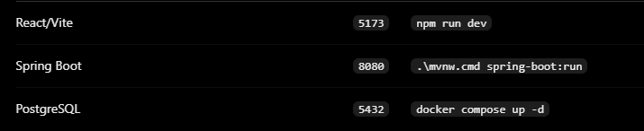

# Geovia
Geovia - platforma internetowa do nauki i weryfikacji wiedzy z geografii świata

Uruchomienie: 
1. Przejdź do katalogu aplikacji ...\Geovia>
2. Uruchom PostgreSQL: **docker compose up -d** (nie ważne w jakim IDE/terminalu)
3. Przechodzimy do backednu: cd backend (np. w IntelliJ) oraz uruchamiamy go: **.\mvnw.cmd spring-boot:run**
4. Backend powinien wystartować na: **http://localhost:8080**
5. Przechodzimy do frontendu: cd frontend\geovia (np. w VSCode) a następnie: **npm install**, **npm run dev**
6. Projekt powinien wystartować na: **http://localhost:5173/**

## Konta i poczta

Rejestracja i zmiana adresu e-mail wysyłają link weryfikacyjny przez SMTP. Ustaw zmienne środowiskowe backendu `SMTP_HOST`, `SMTP_PORT`, `SMTP_USERNAME`, `SMTP_PASSWORD`, `SMTP_AUTH`, `SMTP_STARTTLS` oraz `MAIL_FROM`. Linki kierują na `APP_BASE_URL` (domyślnie `http://localhost:5173`). W produkcji ustaw też `AUTH_COOKIE_SECURE=true` i używaj HTTPS.

Po uruchomieniu aplikacji migracje Flyway V3–V5 tworzą tabele kont, sesji, tokenów resetujących hasło i ustawienie widoczności profilu. Starsze profile sprzed wprowadzenia kont pozostają w bazie bez przypisanego konta; usunięcie konta usuwa powiązany z nim profil i wyniki quizów. Nowe avatary są przechowywane lokalnie w `backend/data/avatars` (można zmienić ścieżkę zmienną `AVATAR_STORAGE_DIR`), a baza przechowuje jedynie nazwę pliku.

Uruchamianie Mailpit w osobnym terminalu:
**docker run --rm -p 1025:1025 -p 8025:8025 axllent/mailpit**
